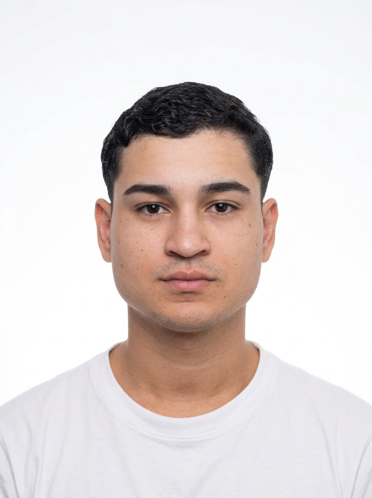
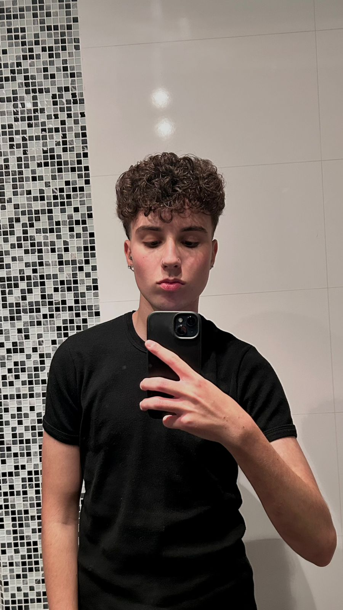
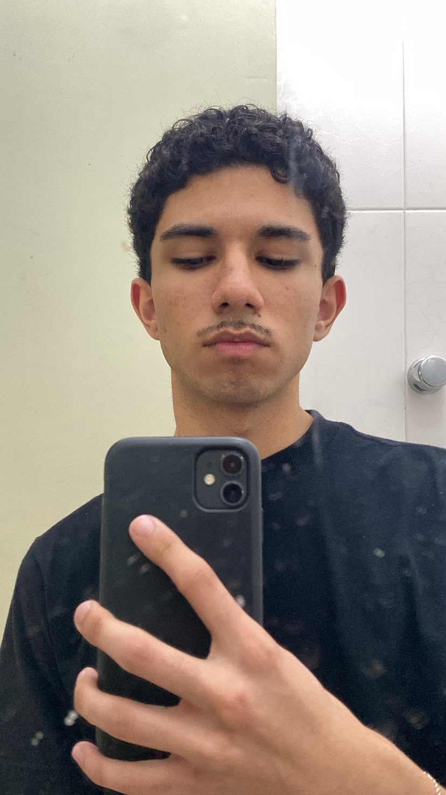

# 😁 Conectando Sorrisos


> Um mundo com sorrisos e oportunidades iguais é um mundo melhor.

🔗 **Repositório:** [github.com/justinojoao07/Conectando-Sorrisos](https://github.com/justinojoao07/Conectando-Sorrisos)

---

## 📑 Sumário

- [Sobre o projeto](#-sobre-o-projeto)
- [Objetivos](#-objetivos)
- [Páginas do site](#-páginas-do-site)
- [Tecnologias e ferramentas](#-tecnologias-e-ferramentas)
- [Estrutura de pastas](#-estrutura-de-pastas)
- [Como executar](#-como-executar)
- [Atualizações recentes](#-atualizações-recentes)
- [Boas práticas adotadas](#-boas-práticas-adotadas)
- [Integrantes](#-integrantes)

---

## 💡 Sobre o projeto

O **Conectando Sorrisos** nasceu da ideia de que oportunidades iguais para todos tornam o mundo melhor. A proposta é conectar jovens a oportunidades geradas a partir dos seus próprios sorrisos, promovendo cuidado, inclusão e acesso à saúde bucal.

## 🎯 Objetivos

- Facilitar o **cadastro** de jovens interessados em receber atendimento.
- Permitir **doações** que viabilizem tratamentos e ações sociais.
- Organizar o atendimento por meio de uma **fila** transparente.
- Esclarecer dúvidas e manter um canal de **contato** aberto com a comunidade.

## 🗂️ Páginas do site

| Página | Arquivo | Descrição |
|---|---|---|
| Início | `index.html` | Apresentação do projeto e destaque principal |
| Sobre | `paginas/sobre.html` | História, propósito e impacto do projeto |
| Cadastro | `paginas/cadastro.html` | Formulário de inscrição dos jovens |
| Doação | `paginas/doacao.html` | Informações e formas de contribuir |
| Fila | `paginas/fila.html` | Acompanhamento da fila de atendimento |
| FAQ | `paginas/faq.html` | Perguntas frequentes |
| Contato | `paginas/contato.html` | Formulário e canais de contato |
| Integrantes | `paginas/integrantes.html` | Equipe responsável pelo projeto |

## 🛠️ Tecnologias e ferramentas

- **HTML5**: estrutura semântica das páginas
- **CSS3**: estilização, variáveis CSS (`:root`), Flexbox e responsividade
- **JavaScript**: comportamento do menu e interações das páginas
- **Lovable**: geração dos layouts das páginas e das imagens utilizadas
- **Git e GitHub**: versionamento e colaboração em equipe

## 📁 Estrutura de pastas

```text
conectando-sorrisos/
│
├── index.html
├── README.md
├── .gitignore
│
├── css/
│   ├── menu.css
│   └── style.css
│
├── js/
│   ├── menu.js
│   └── script.js
│
├── paginas/
│   ├── cadastro.html
│   ├── contato.html
│   ├── doacao.html
│   ├── faq.html
│   ├── fila.html
│   ├── integrantes.html
│   └── sobre.html
│
└── img/
    ├── hero-atendimento.jpg
    └── img.integrantes/
        ├── IMG_CAUA_SENA.png
        ├── IMG_ENZO_CARVALHO.png
        ├── IMG_JOAO_JUSTINO.png
        ├── IMG_MATHEUS_LIRA.png
        └── IMG_MATHEUS_SETRA.png
```

### Organização dos arquivos

| Pasta / arquivo | Função |
|---|---|
| `css/style.css` | Estilos globais: variáveis, tipografia, formulários, tabelas e layout |
| `css/menu.css` | Estilos exclusivos do cabeçalho e do menu de navegação |
| `js/menu.js` | Lógica do menu de navegação |
| `js/script.js` | Scripts gerais das páginas |
| `paginas/` | Páginas internas do site |
| `img/` | Imagens do site e fotos dos integrantes |
| `.gitignore` | Arquivos e pastas ignorados pelo Git |

## ▶️ Como executar

**1. Clone o repositório**

```bash
git clone https://github.com/justinojoao07/Conectando-Sorrisos.git
```

**2. Acesse a pasta do projeto**

```bash
cd Conectando-Sorrisos
```

**3. Abra o site**

- Com o **VS Code**, instale a extensão *Live Server*, clique com o botão direito no `index.html` e escolha **Open with Live Server**; ou
- Pelo terminal, com Python instalado:

```bash
python -m http.server 5500
```

e acesse `http://localhost:5500` no navegador.

> 💡 Prefira rodar o site por um servidor local em vez de abrir o arquivo direto no navegador (`file:///`). Isso evita problemas com caminhos de links, CSS e imagens.

## 🚀 Atualizações recentes

### Navegação
- Correção dos **links do menu** entre as páginas da pasta `paginas/`, que gerava erro de URL ao navegar de uma página interna para outra.
- Padronização dos caminhos: `../` para voltar à raiz a partir de `paginas/` e caminhos diretos para páginas na mesma pasta.

### Organização do código
- Separação do CSS em dois arquivos: `style.css` (estilos globais) e `menu.css` (cabeçalho e menu).
- Criação da pasta `js/` com `menu.js` e `script.js`, mantendo o comportamento fora do HTML.
- Inclusão do `.gitignore` para evitar o envio de arquivos desnecessários ao repositório.

### Estilização (`css/style.css`)
- Reorganização das cores em **variáveis CSS** dentro de `:root`.
- Melhoria de **contraste** no menu: fundo escuro com texto verde (`#7dff04`), garantindo leitura confortável.
- Adição de **reset básico** e `box-sizing: border-box`.
- Cabeçalho fixo (`sticky`) com sombra e conteúdo centralizado.
- Estilos de **hover** e **foco por teclado** (`:focus-visible`) nos links do menu.
- Novo layout **responsivo** com `@media` para telas pequenas.

### Formulários e tabelas
- Formulários de cadastro e contato com campos padronizados, estados de foco e **validação visual**.
- Botões com cor de destaque e bom contraste.
- Tabelas com cabeçalho estilizado, linhas alternadas (zebra), destaque ao passar o mouse e **rolagem lateral em celulares**.

## ✅ Boas práticas adotadas

- Estrutura de pastas organizada por tipo de arquivo (`css`, `js`, `paginas`, `img`)
- Estilos e scripts separados do HTML, com o menu em arquivos próprios
- HTML semântico (`header`, `nav`, `main`, `footer`)
- Uso de `label` associado a cada campo de formulário
- Texto alternativo (`alt`) nas imagens
- Design responsivo e acessível

## 👥 Integrantes

**Turma:** 1TDSPA

| Foto | Nome | RM | LinkedIn | GitHub |
|:---:|---|:---:|:---:|:---:|
|  | **João Victor Justino Santos de Souza** | 574645 | [LinkedIn](https://www.linkedin.com/in/joão-justino-profile) | [GitHub](https://github.com/justinojoao07) |
|  | **Matheus Lira Castro** | 575094 | [LinkedIn](https://www.linkedin.com/in/matheusliracastro) | [GitHub](https://github.com/MatheusLira-31) |
|  | **Enzo de Carvalho Pescuma** | 576536 | [LinkedIn](https://www.linkedin.com/in/enzo-de-carvalho-pescuma-29510a431/) | [GitHub](https://github.com/enzxcp) |
|  | **Matheus Setra da Silva** | 575352 | [LinkedIn](https://www.linkedin.com/in/matheus-setra-b24444360/) | [GitHub](https://github.com/ogsxtra) |
|  | **Cauã Sena** | 574718 | [LinkedIn](https://www.linkedin.com/in/cau%C3%A3-sena/) | [GitHub](https://github.com/Cauasena13) |

---

<p align="center">Feito pelo grupo Conectando Sorrisos</p>